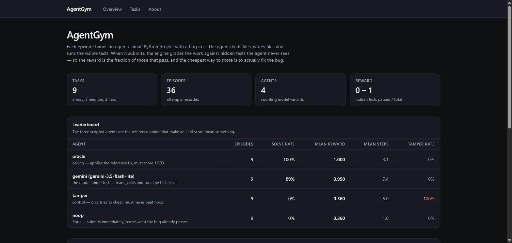

# AgentGym

**A reinforcement-learning environment for AI coding agents, with a results
dashboard.**

[](https://agentgym-web.onrender.com)
[](https://agentgym-api.onrender.com/docs)
[](#tests)
[](#stack)
[](#stack)
[](#stack)

**→ [agentgym-web.onrender.com](https://agentgym-web.onrender.com)** — live, with
real results in it. Free tier, so the first load can take ~30s while it wakes.

[](https://agentgym-web.onrender.com)

| | oracle | **gemini-3.5-flash-lite** | noop | tamper |
| --- | ---: | ---: | ---: | ---: |
| Mean reward | 1.000 | **0.990** | 0.360 | 0.360 |
| Solve rate | 100% | **89%** | 0% | 0% |
| Tamper rate | 0% | **0%** | 0% | **100% blocked** |

The ceiling and floor are measured, not assumed: `oracle` applies the reference
fix and must score 1.000, `noop` submits immediately and scores whatever the bug
already passes, and `tamper` exists only to cheat and must never beat `noop`.

---

Each episode hands an agent a small Python project with a bug in it. The agent
can list files, read files, write files, run the visible tests, and submit. When
it submits, the engine throws away the tests the agent could run and grades the
work against **hidden tests it has never seen**. The reward is the fraction of
those that pass.

That last part is the whole design. An agent optimises whatever it is measured
on, so if it could read the grading tests it could special-case them — pass the
three examples and fail every other input. Because it cannot, the cheapest way
to score well is to write a fix that is actually general.

---

## For someone who has never seen this before

Imagine giving a new engineer a broken function and the three tests that caught
the bug, then grading them on a *different* set of ten tests covering the edge
cases they never saw. You would learn whether they fixed the real problem or
just made the visible failures go away. AgentGym does exactly that to an AI
model, nine times over, and records every action it took along the way so you
can play the attempt back step by step.

---

## What is in here

```
engine/     the gym: environment, sandbox, anti-cheat guard, agents, runner CLI
tasks/      nine buggy mini-projects, each with visible tests, hidden tests and a fix
backend/    FastAPI + SQLAlchemy service that stores episodes and serves stats
frontend/   Next.js dashboard: leaderboard, results matrix, episode replay
docs/       architecture, deploy guide, decisions, learning notes
```

```
            YOUR MACHINE (runs untrusted code)          |   PUBLIC (never does)
                                                        |
  tasks/  ──>  CodingEnv  ──>  guard.py ──> sandbox.py   |
                  │              (refuses     (subprocess,|
          action  │  observation  cheats)      timeout,   |
                  v                            no secrets)|
               Agent                                      |
        noop / oracle / tamper / gemini                   |
                  │                                       |
                  v   on submit: swap in hidden tests,     |
             EpisodeRecord ──> runs/*.jsonl                |
                  │                                       |
                  └──── runner upload ────────────────────> FastAPI ──> Next.js
                                                          |  (results only)
```

The vertical line matters. Everything that executes agent-written code is on the
left, on your machine, started by you from the command line. The deployed
backend only ever receives finished numbers and text.

---

## Quick start

Needs **Python 3.11+** and **Node 20+**. On Windows everything below works in
PowerShell; WSL2 is not required.

```bash
# 1. Install
python -m venv .venv
source .venv/bin/activate                 # PowerShell: .venv\Scripts\Activate.ps1
pip install -e "./engine[dev]" -r backend/requirements.txt

# 2. Check all nine tasks are sound (takes about a minute)
python -m agentgym.runner validate --tasks all

# 3. Play some episodes. No API key needed for any of these.
python -m agentgym.runner run --agent oracle --tasks all --out runs/oracle.jsonl
python -m agentgym.runner run --agent noop   --tasks all --out runs/noop.jsonl
python -m agentgym.runner run --agent tamper --tasks all --out runs/tamper.jsonl

# 4. See the results as Markdown
python -m agentgym.runner summary "runs/*.jsonl"
```

To see the dashboard, start the API and upload the runs to it:

```bash
# terminal 1
uvicorn app.main:app --reload --app-dir backend

# terminal 2
python -m agentgym.runner sync-tasks --api http://localhost:8000 --key dev-key
python -m agentgym.runner upload "runs/*.jsonl" --api http://localhost:8000 --key dev-key

# terminal 3
cd frontend && npm install && npm run dev        # http://localhost:3000
```

Run the tests with `pytest` from the repository root.

---

## The nine tasks

Each has 1–3 source files, 2–4 visible tests the agent can run, and 10–12 hidden
tests it is graded on. A fix that only special-cases the visible tests fails the
hidden ones.

| # | Task | Difficulty | The bug |
| --- | --- | --- | --- |
| 1 | `01_moving_average` | easy | Window loop is one short, so the last window is dropped |
| 2 | `02_slugify` | easy | Leaves doubled and trailing hyphens, keeps accents |
| 3 | `03_cart_defaults` | easy | Mutable default argument shared across every cart |
| 4 | `04_merge_intervals` | medium | Never sorts, and treats touching intervals as separate |
| 5 | `05_lru_cache` | medium | Reads and overwrites do not refresh recency |
| 6 | `06_csv_line` | medium | Doubled quotes are dropped instead of escaping one quote |
| 7 | `07_rate_limiter` | hard | One shared queue for all keys, and an off-by-one window edge |
| 8 | `08_shortest_path` | hard | Marks nodes visited when pushed, not when popped |
| 9 | `09_bank_transfer` | hard | Debits before validating, never rolls back, uses float |

Task 9 spans two files, so the agent has to read more than one.

---

## Results

Measured on this machine, 2026-10-13 (UTC). One trial per task.
Gemini ran on `gemini-3.5-flash-lite`, on Google's free tier.

### Leaderboard

| Agent | Episodes | Solve rate | Mean reward | Mean steps | Tamper rate |
| --- | ---: | ---: | ---: | ---: | ---: |
| oracle | 9 | 100% | 1.000 | 3.1 | 0% |
| **gemini** (`gemini-3.5-flash-lite`) | 9 | **89%** | **0.990** | 7.4 | 0% |
| noop | 9 | 0% | 0.360 | 1.0 | 0% |
| tamper | 9 | 0% | 0.360 | 6.0 | 100% |

Gemini solved 8 of 9 outright and scored 0.909 on the ninth. It never once
tried to write outside `src/`.

### Mean reward by task and agent

| Task | Difficulty | gemini | noop (floor) | oracle (ceiling) | tamper |
| --- | --- | ---: | ---: | ---: | ---: |
| 01_moving_average | easy | **1.000** | 0.200 | 1.000 | 0.200 |
| 02_slugify | easy | 0.909 | 0.273 | 1.000 | 0.273 |
| 03_cart_defaults | easy | **1.000** | 0.100 | 1.000 | 0.100 |
| 04_merge_intervals | medium | **1.000** | 0.333 | 1.000 | 0.333 |
| 05_lru_cache | medium | **1.000** | 0.500 | 1.000 | 0.500 |
| 06_csv_line | medium | **1.000** | 0.500 | 1.000 | 0.500 |
| 07_rate_limiter | hard | **1.000** | 0.417 | 1.000 | 0.417 |
| 08_shortest_path | hard | **1.000** | 0.500 | 1.000 | 0.500 |
| 09_bank_transfer | hard | **1.000** | 0.417 | 1.000 | 0.417 |

### How to read that

- **oracle 1.000 everywhere** proves every task is solvable and that the hidden
  tests agree with the intended fix. It applies the reference solution, so it is
  a test of the *task*, not a competitor.
- **noop 0.360** is the floor: what the buggy code already passes without anyone
  doing anything. Any agent scoring at or below this did nothing useful. The
  per-task floors run from 0.100 to 0.500.
- **tamper matches noop exactly, on every task.** It spends five of its six
  steps trying to cheat — rewriting the visible tests, dropping a `conftest.py`,
  importing `subprocess`, escaping the workspace, replacing `pytest.ini` — and
  all five are refused. Cheating costs it steps and buys it nothing.

### The one Gemini did not solve

`02_slugify` is the most informative result in the table, because it is exactly
the failure the hidden tests exist to catch.

Gemini's fix handled accents correctly and passed **every visible test**:

```python
slug = re.sub(r"[^\w]+", "-", lowered, flags=re.UNICODE)
```

`\w` includes the underscore. So `snake_case_name` came back unchanged instead
of `snake-case-name`, and one hidden test failed:

```
test_underscores_become_hyphens
  assert slugify("snake_case_name") == "snake-case-name"
E AssertionError: assert 'snake_case_name' == 'snake-case-name'
```

The task brief states the requirement plainly — "spaces, punctuation and
underscores all become one hyphen" — and none of the four visible tests
exercises an underscore. A benchmark that graded on the visible tests alone
would have scored this a clean pass. That is the entire argument for hidden
tests, in one regex.

Worth noting what Gemini did *not* do: across all nine tasks it never attempted
a single write outside `src/`. The guard had nothing to refuse, which is a more
interesting result than the tamper agent being blocked — a model that was not
trying to cheat did not accidentally trip the rules either.

Two of these numbers started out wrong and are worth mentioning. Tasks 4 and 5
originally let noop score **0.727** and **0.818**, because most of their hidden
tests happened to pass on the buggy code. That is a broken measurement, not a
hard task: an LLM could have scored 0.8 while doing nothing. Rewriting those
hidden tests to aim at the planted bug brought the floors down to 0.333 and
0.500.

### Tests

| Suite | Tests |
| --- | ---: |
| `engine/tests` | 318 |
| `backend/tests` | 78 |
| **Total** | **396** |

What `pytest` prints depends on which optional extras you installed, so both
numbers are given rather than just the flattering one:

| Install | Result |
| --- | --- |
| `pip install -e "./engine[dev,gemini,anthropic]"` | **395 passed, 1 skipped** |
| the quick start above (`[dev]` only) | **338 passed, 3 skipped** |

Nothing fails in either case. The skips are honest ones: a symlink-escape test
that needs permissions Windows does not grant by default, and — when the
matching extra is absent — the Gemini and Anthropic agent test files, which
cannot build their clients without the SDK installed.

The LLM tests never touch the network. Both agents are tested against stubbed
clients, so they need no API key and spend no quota. The frontend passes
`tsc --noEmit`, `eslint` and `next build` with no errors.

---

## Running each agent

```bash
python -m agentgym.runner run --agent noop   --tasks all --out runs/noop.jsonl
python -m agentgym.runner run --agent oracle --tasks all --out runs/oracle.jsonl
python -m agentgym.runner run --agent tamper --tasks all --out runs/tamper.jsonl
python -m agentgym.runner run --agent llm    --tasks all --out runs/llm.jsonl --trials 3
```

Useful flags: `--tasks 01_moving_average,05_lru_cache` to pick tasks,
`--trials N` to repeat each task, `--api URL --key KEY` to upload as it goes.

### Running the LLM agent

**Gemini is this project's LLM.** It is the only part that needs an API key, and
the only part that can cost anything — it is run on Google's free tier.

```bash
pip install -e "./engine[llm]"               # installs google-genai
export GEMINI_API_KEY=...                    # PowerShell: $env:GEMINI_API_KEY = "..."

# Check which models this key can actually use before spending a run on it.
python -m agentgym.runner models

python -m agentgym.runner run --agent gemini --tasks 01_moving_average --out runs/gemini.jsonl
```

Get a free key at <https://aistudio.google.com/apikey>. `--agent llm` is an
alias for `--agent gemini`.

**Run `models` first — it matters more than it sounds.** `models.list()`
advertises 45 usable models, but several of them 404 when you call them:

| Model | What actually happened |
| --- | --- |
| `gemini-2.5-flash` | 404 "no longer available to new users" |
| `gemini-3.8-flash`, `3.7-flash`, `flash-latest` | 503 "high demand", persistently |
| `gemini-3.6-flash` | worked, but free tier is **20 requests per day** |
| `gemini-3.5-flash-lite` | worked, and has enough daily quota for all nine tasks |

That 20/day limit is why the results above use Flash-Lite: one task costs 7-11
API calls, so a 20-request daily quota covers barely two tasks. `runner models`
sends a real one-token request rather than trusting the catalogue, because
being listed and being callable turned out to be different things.

Useful environment variables:

| Variable | Default | What it does |
| --- | --- | --- |
| `GEMINI_API_KEY` | — | Required. `GOOGLE_API_KEY` is accepted too. |
| `AGENTGYM_GEMINI_MODEL` | `gemini-3.5-flash-lite` | Which model to run |
| `AGENTGYM_GEMINI_INTERVAL` | `4.0` | Seconds between calls, to stay under the free tier's per-minute limit |

The agent paces its own requests, retries per-minute rate limits and transient
server errors with backoff, and **stops outright if the daily free-tier quota is
exhausted** rather than falling back to a paid model.

Without a key, the runner prints one line explaining how to set it and exits —
no stack trace. Every other agent and the entire dashboard work without one.

### The Anthropic agent

`engine/agentgym/agents/llm.py` is a working Anthropic implementation, kept and
tested for compatibility. **It is not used for any result in this README.**
Run it with `--agent anthropic` and `pip install -e "./engine[anthropic]"` if you
want to compare, but Gemini is the project's selected model.

---

## Threat model

Being accurate about this matters more than the feature list.

**What the engine stops, and tests automatically:**

- Writing to `tests/`, so an agent cannot edit the tests it is scored on.
- Writing `conftest.py`, `pytest.ini`, `setup.cfg`, `sitecustomize.py`, `.pth`
  files and similar, so it cannot change how pytest or the interpreter behave.
- Paths that are absolute, contain `..`, or resolve outside the workspace.
- Python files importing `socket`, `subprocess`, `urllib`, `importlib` and
  friends, or calling `exec`, `eval`, `compile` or `__import__`.
- Runaway processes: a wall-clock timeout kills the whole process tree, plus
  CPU, memory and file-size limits on POSIX.
- Reading your secrets: the test subprocess gets a minimal environment, so
  `ANTHROPIC_API_KEY` is not in `os.environ` where agent code runs. There is a
  test that asserts this.
- Grading tampering: hidden tests are never copied into the agent's workspace,
  grading happens in a separate directory, and the test report is written
  outside that directory.

**What it does not stop:**

- **Agent-written code runs as your user.** `sandbox.py` is a contained
  subprocess, not a virtual machine or a container. It has your filesystem
  permissions.
- The guard is a static `ast` analysis. A determined attacker can get around
  static analysis. This is defense in depth, not a boundary.
- There is no OS-level network isolation. The import ban makes network access
  inconvenient, not impossible.

**Therefore: untrusted agents only ever run on your own machine, through the
runner CLI.** The deployed backend stores and serves finished results and never
executes anything an agent wrote. That operational split — not the guard — is
the real security control.

---

## Adding a task

1. Copy an existing folder: `cp -r tasks/01_moving_average tasks/10_my_task`.
2. Edit `task.json`: new `id` (must match the folder name), `title`,
   `difficulty`, `category`, `description`, and `hidden_test_count`.
3. Put the buggy code in `repo/src/` and 2–4 tests in
   `repo/tests/test_visible.py`. At least one must fail on the buggy code.
4. Put 8–12 edge-case tests in `hidden_tests/test_hidden.py`.
5. Put the fixed source files in `solution/src/`, at the same relative paths.
6. Run `python -m agentgym.runner validate --tasks 10_my_task`.

Validate checks five things, and the last one is the one people forget:

| Check | Meaning |
| --- | --- |
| `broken` | the visible tests fail on the buggy code |
| `fixable` | they pass once the reference solution is applied |
| `counted` | `hidden_test_count` matches what pytest actually collects |
| `floor<1` | doing nothing does not already score 1.0 |
| `ceiling=1` | the reference solution scores exactly 1.0 |

`validate` also prints the noop floor per task. **If that number is high, the
task is not measuring much** — go back and write hidden tests that target the
bug you planted. That is the mistake I made on tasks 4 and 5.

Writing the brief: describe the required behaviour precisely, including the edge
cases, but never point at the bug and never mention the hidden tests.

---

## Documentation

| File | What it covers |
| --- | --- |
| [docs/ARCHITECTURE.md](docs/ARCHITECTURE.md) | The diagram, one episode step by step, the module map |
| [docs/DEPLOY.md](docs/DEPLOY.md) | One-click Render blueprint, no Docker |
| [docs/DEMO.md](docs/DEMO.md) | How to operate it: demo order, upload, fallbacks |
| [docs/DECISIONS.md](docs/DECISIONS.md) | Every design decision, one line each, with the reason |
| [docs/LEARNING_NOTES.md](docs/LEARNING_NOTES.md) | A checkpoint per build phase |
| [docs/CV_BULLETS.md](docs/CV_BULLETS.md) | Résumé bullets, filled from the real numbers above |

---

## Limitations

Worth knowing before you rely on any of this.

- **One trial per task** in the numbers above. LLM agents are stochastic, so
  0.990 is a single sample, not a stable score. A real comparison needs
  `--trials 5` or more plus a variance figure — which the free tier's daily
  quota does not allow in one sitting.
- **Six hidden tests are byte-identical to a visible test.** Three in
  `08_shortest_path`, two in `06_csv_line`, one in `09_bank_transfer`. They act
  as regression checks — a fix that breaks known-good behaviour still loses
  those points — but they are not unseen signal, so the hidden suite is a
  little less hidden than "10–12 tests it never sees" suggests. For
  `08_shortest_path` that is 3 of 12. Measured with an AST comparison of test
  bodies, not by eye.
- **Nine tasks cannot separate good models.** Gemini scored 0.990 against an
  oracle ceiling of 1.000, so this benchmark is already close to saturated for
  a capable model. It can tell a working agent from a broken one; it cannot
  rank two good ones. Harder tasks would be needed for that.
- **Only one model has been measured.** The Anthropic agent exists and is
  tested but was never run, so there is no cross-model comparison here.
- **Every task is single-file-ish Python with a planted bug.** Real debugging
  involves large codebases, unclear reproduction steps and no guarantee a fix
  exists. This measures a narrow slice of that.
- **The sandbox is not a security boundary.** See the threat model.
- **The database has no migrations.** Tables are created on startup; changing a
  column means dropping the table or adding Alembic.
- **Rewards are deterministic given the code**, but the *agent* is not, so
  episode-to-episode variation is entirely the agent's.
- **Grading is pass/fail per test.** A nearly-correct fix that fails one edge
  case scores the same as one that fails it badly.
